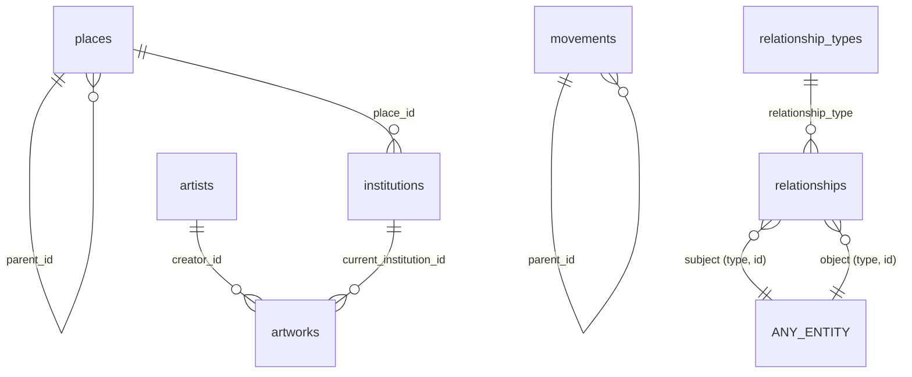

# Data model

PostgreSQL 18 + PostGIS 3.6. Schema lives in [`db/migrations/`](../db/migrations/) — never edit an applied
migration; add a new numbered file instead.



`ANY_ENTITY` = artists · artworks · institutions · people (patrons before 024) · movements · places · polities.

## Entity tables
One table per entity type, each with its own columns. Shared conventions:

| Column | Purpose |
|---|---|
| `id bigint identity` | internal key, used in relationships |
| `slug` (unique, `kebab-case`) | stable public key: URLs, import upserts (`ON CONFLICT (slug)`) |
| `wikidata_id` (unique, `Q…`) | optional, for de-duplication and later enrichment |
| `metadata jsonb` | free-form extras (sources, dimensions …) — must be an object |
| `*_md` | Markdown; rendered with markdown-it and **sanitized** server-side before reaching the frontend |
| `created_at` / `updated_at` | `updated_at` maintained by trigger |

## Fuzzy dates → `daterange`
Historical dates are rarely exact, so every date is a **half-open range** plus a display label:

| Meaning | Stored value | Label |
|---|---|---|
| 30 March 1853 | `[1853-03-30, 1853-03-31)` | `30 March 1853` |
| 1760 | `year_range(1760)` → `[1760-01-01, 1761-01-01)` | `1760` |
| c. 1480 | `year_range(1478, 1482)` | `c. 1480` |
| 500 BCE | `year_range(-500)` | `500 BCE` |
| since 1808 (ongoing) | `[1808-01-01,)` — infinite upper bound | `since 1808` |

Open ends are for periods only (relationships, `movements.period`, `people.active`), never for births, deaths,
creation or founding dates. An ongoing period overlaps every later window, which is what "still there" means.

This makes timeline queries plain range operators, backed by GiST indexes:
`lifespan @> date '1850-01-01'` (alive then), `period && year_range(1860, 1890)` (overlaps).
`artists.lifespan` is a stored generated column (earliest birth → latest death).

## Places & geography
`places.location geography(Point, 4326)` (map marker) and optional `area geography(MultiPolygon, 4326)` for regions,
both GiST-indexed. `geography` measures in metres on the sphere: `ST_DWithin(a.location, b.location, 150000)` = within 150 km.
The API returns GeoJSON (`ST_AsGeoJSON`) — nothing tile-specific; basemap tiles come from MapTiler.
Places form a hierarchy via `parent_id` (Arles ⊂ Provence ⊂ France).

## Relationships
One generic edge table: `(subject_type, subject_id) —relationship_type→ (object_type, object_id)`,
with optional `period`, `period_label`, `label`, `certainty` (attested/probable/possible/disputed), `notes_md`.

**All** entity-to-place links (born in, lived in, created in, inspired by …) are relationships, not columns —
an artist can have any number of them, each with its own dates.

### Vocabulary (`relationship_types`, seeded in migration 002)
Each type declares which entity types it may connect, its inverse label, and two flags:

- `is_physical_presence` — the subject was physically there (`born_in`, `died_in`, `lived_in`, `worked_in`,
  `visited`, `created_in`, `located_in`). **Only these may be drawn as travel routes.** Non-physical links
  (`influenced_by_culture_of`, `depicts`, `active_in`) go on a visually distinct layer — e.g. Van Gogh's
  Japonisme traces to Japan without implying he travelled there.
- `is_symmetric` — `contemporary_of`, `collaborated_with` are stored once in canonical order (A↔B = B↔A).
- Migration 007: `inspired_by_place` removed (overlapped with `influenced_by_culture_of`); `depicts` (artwork → place:
  the place is the subject) added; `owned_by`, `commissioned` and `patron_of` also accept institutions (church, guild,
  museum) and places (a city or state as a public body). A state is a polity (migration 019).
- Every relationship is stored in one direction (subject → object). The admin form also offers the reverse types
  ("commissioned by" on an artwork's page) and swaps them into canonical order on save.

Query the current list: `SELECT code, label, subject_types, object_types FROM relationship_types ORDER BY sort_order;`

### Integrity (what foreign keys can't do here)
Postgres FKs can't point at "a row in one of six tables", so triggers enforce it:

- `relationships_validate` (before insert/update): type allows this subject/object entity type; both ids exist;
  symmetric edges normalised.
- `<table>_delete_relationships` (after delete on each entity table): removes that entity's edges in both directions.
- Unique `NULLS NOT DISTINCT (subject, type, object, period)` — no exact duplicates; repeats with different periods are fine.
- Current vs. history: `artworks.current_institution_id` / `institutions.place_id` hold where something is **now**;
  earlier holdings/locations are dated `housed_at` / `located_in` relationships (migration 005), needed only when it moved.
- Plain FKs (`creator_id`, `current_institution_id`, `place_id`, `parent_id`) are `ON DELETE RESTRICT`:
  curated data is never removed implicitly.

### Querying both directions
- "Who influenced X": `WHERE subject_type='artist' AND subject_id=X AND relationship_type='influenced_by'` (unique index)
- "Whom did X influence": `WHERE object_type='artist' AND object_id=X AND relationship_type='influenced_by'` (`relationships_object_idx`)
- Chains: `WITH RECURSIVE … CYCLE object_type, object_id SET is_cycle USING path` — see `db/tests/schema_smoke.sql`.

## Read-API helpers (migration 004)
- `f_unaccent(text)` — IMMUTABLE wrapper around `unaccent()` so it can be indexed; trigram GIN indexes on
  `f_unaccent(name)` of every entity table serve `ILIKE '%…%'` and `<%` (word similarity) → accent-insensitive fuzzy search.
- `range_json(daterange, label)` → `{label, from, to (inclusive), from_year, to_year}` — the API's date shape.
- `entity_index` view — `UNION ALL` of all six tables as `(type, id, slug, name, period, period_label, kind)`;
  filters on `type`/`id` are pushed down into each branch, so lookups still use primary keys.

## Admin working copies (migrations 010, 011)
`admin_drafts` holds per-user drafts of *new* entries. `live_docs` holds one shared working copy per existing entry
being edited: a Yjs document (`state bytea`, the CRDT's binary encoding), the entry version it is based on, whether it
differs from the published row, and who changed it. Neither is content: not audited, invisible to the API role.
Publishing goes through the normal save path (validation, optimistic locking, audit log).

## Artwork dimensions and materials (migration 015)
`height_cm`, `width_cm`, `depth_cm` are `numeric(8,2)` (exact decimals) with one rule (migration 020): each value only
together with the ones before it — height alone (a sculpture), height × width, or all three. `materials text[]` complements the free-text `medium`; its GIN index serves containment queries
(`materials @> ARRAY['bronze']`, the API's `?material=`). In YAML and forms: `dimensions: [h, w]` / `[h, w, d]`.

Further measurements (migration 025): `other_dimensions jsonb` `[{part, cm: [h, w, d]}]` — mount, frame, sheet,
overall … — validated by `CHECK other_dimensions_valid()`; the main columns stay the work itself.

### Constraints added NOT VALID (migration 016)
`artworks_inventory_needs_institution` was added `NOT VALID`: Postgres enforces it for new and changed rows but has
not checked the existing ones (one violated it). The quality view lists remaining violations; when none is left,
`ALTER TABLE … VALIDATE CONSTRAINT` checks all rows once without blocking writes, and the constraint is fully valid.

## Images (migration 017)
Artworks, artists and institutions can have several images (front, back, detail, installation view …) in one table
`images (url, source_url, license, credit, caption, position)`. It belongs to exactly one entry through an
**exclusive arc**: three nullable foreign keys `artwork_id`, `artist_id`, `institution_id` and
`CHECK (num_nonnulls(artwork_id, artist_id, institution_id) = 1)`. Unlike the generic `relationships` table (any entity
type, checked by triggers), real foreign keys work here — and `ON DELETE CASCADE` takes an entry's images with it.
Per arc a partial index `(…_id, position)` serves "the images of this entry, in order", and a partial **unique** index
`(…_id, url)` keeps the same image from being added twice (the YAML import upserts by it:
`ON CONFLICT (artwork_id, url) WHERE artwork_id IS NOT NULL` — the predicate selects the partial index).
Arms added later: `glossary_id` (027), `person_id` (043). Since 043 the owner is also stored as two **generated columns**
`entity_type`/`entity_id` (`GENERATED ALWAYS AS (CASE … END) STORED`), so queries join `entity_index` on
`(i.entity_type, i.entity_id)` instead of repeating the CASE over the arms; the literals are typed
(`'artwork'::entity_type`) because a generated column's expression must be immutable.
`ORDER BY position, id`; the first image is the main one (list thumbnail, preview, the API's `image_url`). The API
builds the list with `jsonb_agg(jsonb_build_object(…) ORDER BY position, id)`. The former single-image columns
(014 and earlier) were moved here as position 0 and dropped.

## Several creators (migration 028)
`artworks.creator_id` is the **main** creator: a real foreign key, used by the quality checks (dated outside the
creator's life) and the Wikidata comparison. The rare further creators are relationships `co_creator` (artwork → artist)
rather than a separate join table `artwork_creators(artwork_id, artist_id, role)`. That table would treat all creators
alike and have real foreign keys, but every part of the system that handles relationships (admin form, history,
YAML, graph) would need new code for it. A relationship already carries what a co-creator needs: `label` = their part
("landscape"), `certainty` = how sure the attribution is, `period` if they worked at different times.
`artwork_creators(id)` (SQL function, `STABLE`) joins both sources into one ordered `jsonb` list for the API. The
`?creator=` filter is `creator_id = x OR EXISTS (co_creator relationship)`. Free-text qualifiers ("Workshop of …",
"Attributed to …") stay in `attribution_label`.

**In the graph (migration 029):** the main creator is a vocabulary entry with `derived = true`. The view `graph_edges`
returns the stored relationships `UNION ALL` one computed edge per `artworks.creator_id`, in the same columns, and the
graph walks this view instead of the table. Postgres pushes a `WHERE object_id = …` into both branches of a
`UNION ALL` view, so each branch still uses its own index. Derived types can't be stored (trigger
`relationships_not_derived`) and the admin form doesn't offer them, so the creator is entered in one place only.

## Provenance (migration 031)
Sources record **events** ("bought 1952", "gift 1952"), not ownership periods. Typing an event into a period field
would claim too much: a year means the whole year, and the end of an ownership is usually only *implied* by the next
acquisition. So the table `provenance` stores what the sources say, one step per owner in order (`position`, a
`DEFERRABLE INITIALLY DEFERRED` unique key so reordering can renumber inside a transaction): the owner (an exclusive
arc of four foreign keys — artist, person, institution, place — and/or `owner_label` "Private collection, Paris"),
`acquired`, `method` (enum `acquisition_method`), `direct` (handover documented, the AAM convention "; vs ."),
`location_id` (where the work was), an optional recorded `ended`, certainty, notes, sources.

The view `provenance_periods` computes the chain with **window functions** over `PARTITION BY artwork_id ORDER BY
position`: `lead(acquired)` gives the next acquisition (the implied end), `lag()` the previous owner (for transfers and
the gap check). `end_basis` records where each end comes from: `recorded` · `implied` · `ongoing` (the last owner is
the current institution → open-ended range) · `unknown` (only the acquisition range — nothing invented).

The site stays focused on relationships: the view **`edges`** (replacing 029's `graph_edges`) is the stored
relationships plus derived ones — the main creator, and per step `owned_by`, `kept_in` (presence → the artwork's map
route) and `transferred_to` (previous → next owner). Graph, map, entity pages and the admin "Linked from" read it.
`owned_by` is therefore derived now (the existing rows moved into `provenance`); `relationships_not_derived` refuses
stored derived types. A filter on the owner can't be pushed below the window functions (they partition by artwork),
so `edges` computes the provenance part for the whole table on each query — fine at this size; the people role
`owner` asks `provenance` directly (index `provenance_person_idx`). Quality checks: `provenance_gap_1933_1945` (an
undocumented change of owner whose gap overlaps 30 Jan 1933 – 8 May 1945: `daterange && daterange`),
`provenance_forced_transfer` (confiscation / forced sale without a later restitution), `provenance_last_owner`.


**Roles, joint owners, prices, the chain as read (063).** `provenance.role` (enum `holder_role`): owner · dealer ·
agent (on consignment — held, not owned) · estate (the owner's estate: the person stays linked) · custodian (held
without owning: deposit, loan). `provenance_co_owners`: further owners of a step (an exclusive arc like the step's
owner; view `provenance_co_owners_x` reads it as (type, id)). `price` + `price_currency` (ISO 4217) + `price_note`.
Derived edges: `owned_by` for owners, dealers, estates and every joint owner; `held_by` for agents and custodians;
`commissioned` (owner → artwork) from a step with the method `commission` — a commission is the provenance's first
step, no longer a relationship (Wikidata's P88 adds such a step). The lender's step is `ongoing` while the work is on
loan. **`provenance_chain`** is the provenance as it is read: an implied first line "the artist" from `creator_id` and
`created` (not when the first step is a creation or commission or names the artist; it lasts until the first
acquisition only when that is documented as direct), the recorded steps, and an implied last line for a loan (the
current institution as custodian, from `on_loan_since`). Implied lines are computed, never stored. Dates known from
one side only are open ranges: "26 March 1952 or later" = `[1952-03-26,)`, "28 October 1904 or earlier" =
`(,1904-10-29)` (`src/fuzzy-date.js`).
## Polities and countries (migrations 018, 019)
"Which country is it in today?" and "which polity did it belong to?" are kept apart:
- **Today** is derived, never entered: `place_country(place_id)` walks up `parent_id` with a recursive CTE that stops at
  the first place with a `country_code`; `entity_home_place()` picks the place that counts (birthplace, place of
  creation, an institution's location); `entity_country()` combines them, with the linked polities' `country_codes` as
  fallback when they name exactly one country (`HAVING count(DISTINCT code) = 1`).
- **Polities** (`polities`: states, empires, kingdoms, dynasties) are an entity type with a `period` (when they existed)
  and `country_codes text[]` (ISO codes of the modern countries on their territory; one `CHECK` validates the whole
  array through `array_to_string(…) ~ regex`; GIN index for `@>`). Links are ordinary dated relationships:
  `nationality` (artist/person), `created_in_polity` (artwork), `located_in_polity` (institution) — category
  `polity`, not physical presence, so never drawn as travel. The quality check `outside_polity_period` reports links
  whose period cannot overlap the polity's (`NOT (r.period && p.period)`).
- Adding the type needed two migrations: `ALTER TYPE … ADD VALUE` (018) can't be used in the transaction that adds it.
  `entity_table(type)` maps a type to its table (`polity` → `polities`, not type + "s").

## Names and languages (migration 022)
Each entity table has `<name>_lang` (BCP 47, `CHECK lang_tag_ok()`), `<name>_ruby` (the name with furigana markup
`{base|reading}`; the name column itself stays plain, kept in step by `CHECK ruby_plain(<name>_ruby) = <name>`) and
`names jsonb` — other names `[{text, lang, role}]`, validated by `CHECK names_valid(names)` (a SQL function over
`jsonb_array_elements`). A jsonb column rather than a child table because names belong to the entry: saved,
versioned, reverted, co-edited and exported with it. `names_text()` flattens them (with readings) for search; an
expression GIN index `f_unaccent(names_text(names)) gin_trgm_ops` serves trigram matching. `name_sort_key()` picks the
first romanization for sorting; `entity_index` exposes `names` and `sort_key`. Functions called from index
expressions are schema-qualified inside each other: since Postgres 17, index builds run with a restricted search_path.

Migration 023: `kana_romaji()` (PL/pgSQL, IMMUTABLE) turns kana into Hepburn — katakana → hiragana with `translate()`,
two-character syllables before single ones (`FOREACH … SLICE 1` over a constant array of pairs), っ doubling the next
consonant with `regexp_replace`. `name_alt_text(ruby, names)` = everything besides the name an entry is found by
(other names, readings, romaji long and short); the `<table>_alt_trgm` indexes are on exactly that expression, which
the queries repeat so the planner can use them. `name_sort_key(name, ruby, names)`: the name when it has Latin
letters, else its romanization, else the romaji of its reading.

## People (migration 024)
Patrons became `people`: everyone relevant who isn't an artist (poets, rulers, monks, sitters) and groups (`kind`:
family, dynasty, religious order, guild). Rule: whoever made art is an artist. "Patron" is a role — the patronage
relationships. `ALTER TYPE entity_type RENAME VALUE 'patron' TO 'person'` renamed the type everywhere at once (enum
columns store the label's internal number); text copies were updated by hand (function bodies, the delete trigger's
argument, `audit_log` JSON, quality acknowledgements). New: `birth`/`death` + generated `lifespan` (as artists),
`occupations text[]` (GIN), `notes_md` → `description_md`; relationship `depicts_person` (artwork → person/artist,
category `depiction`, in the graph); people may also be `influenced_by`, `collaborated_with`, `associated_with`, and
teachers (`student_of`).

## Type and materials as glossary terms (migrations 070, 071)
Museums write "woodblock print" or "Holzschnitt", "canvas" or "Leinwand". An artwork's type and materials are
therefore glossary terms (categories `object type`, `technique`, `format` for the type; `material`), whose other names
carry the translations. The **names stay the interface**: `artworks.kind` (text) and `artworks.materials` (text[]) keep
holding names, so the form, YAML, the Wikidata review, revert and the views reading them are unchanged. The database
resolves them:
- `term_by_name(name, categories)` — the term a name means: its main name or any other name, any language, case- and
  accent-insensitive (`f_unaccent`, `ruby_plain` for names with furigana), main-name matches first.
- BEFORE trigger `artworks_link_terms`: sets the real foreign key `kind_term_id` and writes the term's main name
  ("Ölgemälde" → "oil painting"); the materials likewise, each once. AFTER trigger `artworks_material_links`: the join
  table `artwork_materials (artwork_id, term_id, position)` — derived, so not audited (the names are the record).
- AFTER trigger `glossary_relink_artworks`: a renamed term renames it on its artworks (`array_replace` for the
  materials); a new term or a new name links artworks that used it unlinked (`SET kind = kind` re-runs the BEFORE trigger).
- `artwork_term_names(id)`: every name of the artwork's terms — type, materials, and the terms its `medium` mentions as
  a whole word (`~*` with `\m…\M`, the name's regex characters escaped) — for searching in any language.
- A name that is no term stays as typed: check `unlinked_term`, sorted out on `/quality/batch/terms`. In the admin, a
  new single word typed as type or material becomes a term (flagged "to complete": translations to add); a phrase
  ("oil paint on canvas") doesn't. Object types and materials need no description (no `missing_description`).

## Glossary (migrations 026, 027)
Table `glossary` (entity type `term`; `entity_table('term')` = glossary): name fields as everywhere, `category`
(enum `term_category` — a fixed list, extended with `ALTER TYPE … ADD VALUE`), `definition` (≤ 500 characters),
`description_md`; images (a fourth arm `glossary_id` of the exclusive arc); `related_term` (symmetric). Texts link
terms with `[[slug]]` / `[[slug|words]]` (a markdown-it inline rule in `src/markdown.js`). The view `glossary_links`
finds every link with `regexp_matches(…, 'g')` over all Markdown columns (relationship notes count for their subject):
"used in" and the quality check `broken_glossary_link` read it — computed when asked, so always current.

Links to any entry (migration 030): `[[type/slug]]` / `[[type/slug|words]]` (`[[artist/katsushika-hokusai]]`); a bare
`[[slug]]` stays a glossary term. The view `content_links (entity_type, entity_id, target_type, target_slug)` finds them
all the same way, and `glossary_links` is now `content_links WHERE target_type = 'term'` (same columns, so
`CREATE OR REPLACE VIEW` could redefine it under the quality view that depends on it). `target_type` is text, not
`entity_type`: a typo like `artsit` must become a quality finding (`broken_link`), not a cast error for the whole view.
Backlinks ("mentioned in") read `content_links`. The view scans every text on each call, which is fine at this size.
If it gets slow, it can become a `MATERIALIZED VIEW` refreshed by a trigger, or a links table kept up to date on save.

Links keep the slug as text, so they follow renames (migration 042): `current_links(md)` replaces links to an old slug
(`slug_history`, 041) with the current one — called by `record_slug_change()` for every Markdown column (view
`markdown_columns`) in the rename's transaction (history source `slug rename`), and by a `BEFORE INSERT OR UPDATE OF
<column>` trigger on each, so a stale working copy saved later is corrected. Why not ids in the text (`[[artist:42]]`)?
Ids differ between databases (dev/test/prod, YAML snapshots match by slug) and make the raw text unreadable.

## Place geometry (migration 032)
`boundaries` (reference data, `scripts/boundaries.js`): Natural Earth countries and first-level regions by ISO code,
`geography(MultiPolygon)` with a GiST index, plus a label point. `places.boundary_code` references it; the rule
"a place needs geometry" is `CHECK (location IS NOT NULL OR area IS NOT NULL OR boundary_code IS NOT NULL)`; a BEFORE
trigger fills `boundary_code` for countries from `country_code`. The view `place_geo` gives every place a `marker`
(own point → boundary label point → `ST_PointOnSurface(area)`, a point guaranteed *inside* the shape, unlike a
centroid) and an `outline` (own area → boundary) — a view because a stored generated column can't read another
table. Map, API and the checks read it; `parent_suggestion` finds the smallest outline containing a parentless place
(`ST_Covers` … `ORDER BY ST_Area`), `boundary_available` countries/regions that could have an outline.

## Sites (migration 034)
Institutions have an optional `location` point and `address` (their `place_id` stays the city); immovable artworks an
optional `location` and `area`. The view `site_geo (type, id, marker, outline, place_id)` gives a map point for
places, institutions (own point, else the city's) and located artworks, with the city each counts for — the map routes
join edges to it, so a presence at an institution is drawn at the venue and counted for its city. Vocabulary:
`lived_in`/`worked_in`/`visited` → place or institution, `depicts` → place or artwork, new `houses` (artwork →
institution). Rule of thumb: designed works → artworks; organisations and venues → institutions; plain locations and
natural features → places — and no duplicates.

## Bibliography (migrations 035, 036)
Table `bibliography` (entity type `source`): the name fields, enums `source_kind` and `reading_status`, authors /
editors / compilers as `text[]` ("Surname, Given"), the parts of a reference as plain columns. Citations are text
links `[[source/slug|page]]`, so `content_links` (extended) gives "cited in" and the `broken_link` check for free.
Formatting is application code (`src/bibliography.js`, after the KHIST guide): sigla are disambiguated across the
whole bibliography (a/b), which a per-row SQL function couldn't do; `src/markdown.js` cuts footnotes out before
markdown-it and puts them back numbered.

## Series (migration 037)
`artworks.parent_id` (+ `part_number`, `parts_count`): the parent pattern of places and movements for wholes and
parts. A whole is an artwork entry like its parts. Its kind says whether it is an object (triptych, album,
altarpiece — with a size and a place) or a **group of works** (132): a kind whose glossary term is in the category
`group of works` (series, versions, cycle, pair …; `artwork_is_group(kind_term_id)`). For a group the admin form hides
the empty object fields, the web-page check leaves it out, `group_parts_missing` counts its parts, and the site labels
the parts of versions "Version 2 of 3". `part_sort` is a STORED generated column — the first number in `part_number` — so "No. 21" sorts after "3". A
trigger function `no_parent_cycle()` (dynamic SQL with a recursive CTE and `CYCLE … SET … USING`) refuses loops on
every table with `parent_id`.

## Events (migrations 046, 047)
A type of its own rather than glossary terms: a term is a concept without time and place; an event happened at a time
(`period`, fuzzy like every date, GiST-indexed for "what happened while …"), in a place (`place_id`, the city; plus an
optional exact `location` or covered `area`, like immovable artworks), possibly `parent_id` → a larger event
(`no_parent_cycle()` as for series and movements). Everything else is relationships: `depicts` (artwork → event, an
existing type widened), `participated_in` (artist/person/institution → event, the role in `label`), `concerns` (event →
anything it is about). Adding a type meant: the enum value in its own migration (046 — a new enum value can't be used
in the transaction that adds it), then the table and an event branch in every view over all types (`entity_index`,
`content_links`, `entry_previews`, `dup_facts`, `site_geo`, `quality_issues`), the CASE functions (`entity_exists`,
`entity_id`, `entity_home_place`), the per-table triggers, a sixth image arm — the generated `images.entity_type` /
`entity_id` changed in place with `ALTER COLUMN … SET EXPRESSION` (PostgreSQL 17+).

## The wrong kind of entry (migration 055)
`type_doubt(type, name)` — a guess from the name (an institution with a person's name and no word of an institution;
a person / artist whose name has one) for the live box and the quality check `type_doubtful`; the admin also checks a
Wikidata item's class (`wikidata.typesOf`: human → artist/person …) on the review page and on Create.
`convert_entry(type, id, new_type)` moves an entry to another table: the columns both tables have (via
`pg_attribute`), relationships the new type may have (others removed and listed), image and provenance arms, sources
of fields both have, reference records the authority keeps for the new type; refused while something only the old
type can be points at it (an institution's artworks). `entry_moves` keeps old type + slug → the new entry: admin
and API redirect; `[[old_type/slug]]` links are rewritten. History source `convert`; the admin previews in a
rolled-back transaction.

## Authority files (migration 053)
`authorities` (data: code, name, url template, number pattern, Wikidata property, entity types) and `entry_identifiers`
(entity, authority, value): one number per authority per entry, and `UNIQUE (authority, value)` — a number names one
entry, so the same GND or ULAN number on two entries is refused (a duplicate). A trigger checks the number against the
authority's pattern and that the authority records this type of entry. The Wikidata comparison brings the numbers
(P245, P227, P214, P781, P650, P244). The GND's open data (lobid.org, CC0) is compared like Wikidata
(`src/admin/gnd.js`): taken values are cited with the bibliography source `gnd` (reliability institution) and the
record's page. Getty's data services refused requests from this server (403) — ULAN numbers are links only.
SIKART (SIK-ISEA, migration 057: link to the research portal `recherche.sik-isea.ch/sik:person-{id}/in/sikart`, source
`sikart`, reliability scholarly) is compared the same way (`src/admin/sikart.js`, the portal's API, one record on
request): birth and death with their places from the biographical note, its GND and VIAF numbers as reference records;
Heimatort and citizenship are shown, not stored. In both comparisons a place we don't have is looked up in OpenStreetMap (settlements) and
created on Apply like a city found on save; every item is ticked by default and can be unticked.
059 adds `bnf`, `idref`, `hls`, `dodis`, `fotoch` to `authorities`. Persons are also compared with RKD (`rkd.js`,
CIDOC-CRM birth/death events whose places carry their Wikidata item), the Library of Congress (`lc.js`, EDTF dates)
and the BnF (`bnf.js`, SPARQL) — each reader produces one record shape that `records.js` turns into the comparison.
Metagrid (`metagrid.js`) finds the numbers by name: the Enrich page adds them as reference records.
060 adds `kulturnav` and `nlk`; their readers (`kulturnav.js`, `nlk.js`) use the same record shape, which can carry
other names (offered as checkboxes, appended to `names`). ArCo (`arco.js`) lists the works Italy's national catalogue
has for a person (by Wikidata item) — information only. Without a SIKART number, "Find in SIKART…" searches by name. Facts
only — SIKART's lexicon texts and images are linked, not copied (no published terms for the API).

## Sources for facts (migration 049)
`citations`: this value is supported by this source — a field of an entry (`entity_type`, `entity_id`, `field`, from
the table `citable_fields`, which also names each field's columns and Wikidata property), a relationship or a
provenance step (real foreign keys, ON DELETE CASCADE); the source is a bibliography entry or a Wikidata item (exactly
one: CHECK `num_nonnulls() = 1`). `cited_value` = `field_value(row, cols)` when cited; the view `citation_status`
compares it with the current value (`outdated`) and gives each citation a `reliability` (enum `source_reliability`:
database < institution < scholarly < primary — enums compare in declaration order, so `max()` is "the best source";
a bibliography entry's from its kind unless set in `bibliography.reliability`). `field_sourcing`: every field with a
value and its best still-valid citation → quality checks `weakly_sourced` (info, per entry) and `citation_outdated`.
`entity_rows` gives every entry as `to_jsonb(row)`, so fields are read generically. Wikidata cites itself: values taken
in a comparison become `pending` citations (the form values expected) and are settled by `saveEntity` on publish; a
new entry carries them in the form (`wd.cite`); relationships and auto-created entries are cited at once. The
migration backfilled what demonstrably came from Wikidata (the "Wikidata Q… (retrieved …)" notes, accepted
`wikidata_reviews`).

## Numbers and loans (migration 048)
`artworks.inventory_number` is the number of the institution where the work is now (`current_institution_id`, as
decided with 005); further numbers are rows of `artwork_numbers` (number + an institution, a bibliography source for a
catalogue raisonné, or a label). An institution gives each number once — across the main and the further numbers, so a
unique index can't express it (it covers one table): `institution_number_free()`, called by BEFORE triggers on both
tables, with `pg_advisory_xact_lock(hashtextextended(…))` so two concurrent saves of the same number serialize.
Catalogue numbers are unique per catalogue by a plain partial unique index. `on_loan` / `on_loan_since`: the holder is
not the owner on purpose (a Dauerleihgabe); the quality check `provenance_last_owner` skips loans, `loan_owner` asks
for the lender. Duplicates weigh every number (`artwork_number_keys()` → `dup_facts.numbers`, `&&` overlap); a merge
keeps shared numbers once and the duplicate's main number as a further one.

## Duplicates (migration 044)
Four layers, all in SQL so the create form, the live box and the quality page agree:
1. **Hard rules** — partial unique indexes: `artworks (current_institution_id, lower(btrim(inventory_number)))` (an
   inventory number identifies an object within its collection) and `places (boundary_code)`; with the existing
   unique `wikidata_id` per table.
2. **Evidence, not names alone** — `dup_facts` (a view: one row per entry, the same columns for every type) and
   `dup_score(a dup_facts, b dup_facts, OUT score, OUT reasons)`: name similarity (pg_trgm over every name incl.
   translations, `dup_names()`/`names_similarity()`), plus/minus points per type — creator, dates (`&&` on ranges),
   dimensions (1 cm/2 % same, 3 cm/5 % different), collection, inventory number (the same: +100; two different
   ones in the same collection: −100, 045), series part, life dates, place kind,
   distance (`ST_Distance` on geography), city, website host, DOI/ISBN/year/authors. A view's row type can be a
   function argument, which is what makes `dup_score(a, b)` work on rows of the view. `dup_maybe()` is the cheap
   prefilter. ≥ 50 shown (quality check `possible_duplicate`, live box), ≥ 70 Create asks first. The check runs
   *inside* the save: the new row is inserted, `duplicate_candidates(type, id)` compares it, and an unconfirmed hit
   rolls the transaction back (the live box does the same and always rolls back — one code path, no second copy
   of the rules in JavaScript).
3. **"Not the same"** — stored as the quality acknowledgement of the pair (`quality_acks`, key
   `dup:<smaller id>:<larger id>`); `duplicate_candidates()` leaves acknowledged pairs out.
4. **Merge** — `merge_entries(type, keep_id, dup_id) → jsonb`: relationships (doubles and self-links dropped), every
   foreign key to the table (found in `pg_constraint`, so later tables are covered), images and provenance appended,
   bookkeeping; deletes the duplicate, its slug → `slug_history` (redirect), `[[links]]` rewritten (042); empty fields
   of the kept entry filled in groups (a date with its label, all dimensions, institution with inventory number), the
   duplicate's names become other names. History source `merge`; the admin's preview runs it and rolls back.

## Auto-created entries (migration 021)
A creator or institution typed into an artwork form as a new name is created with the save (same transaction, so a
revert removes both); entries the Wikidata comparison creates too. Each gets a row in `auto_created` (type, id, the
entry being saved, who, when) until it is next published or marked complete; the quality view lists them
(`auto_created`, warning), the admin list shows "to complete". The generic delete trigger
`delete_entity_relationships()` also removes the row — one `CREATE OR REPLACE FUNCTION` covers every entity table.

## Data quality (migrations 013, 058)
`quality_issues_live` is a view with one `SELECT` per check (`UNION ALL`): `check_id, severity, entity_type, entity_id,
issue_key, detail`. The date checks are range operators — `&&` overlap, `<<` entirely before, `>>` entirely after,
`*` intersection — so fuzzy dates only count as a contradiction when they cannot overlap at all. Place outlines use
PostGIS `ST_Covers(parent.area, child.location)`; duplicates `similarity()` from pg_trgm. Findings confirmed as correct
go into `quality_acks (check_id, issue_key)` and are filtered out with a `LEFT JOIN … WHERE a.check_id IS NULL`.

**Stored result (058), kept up to date incrementally (125).** Pages read the table `quality_issues` (same columns),
never the view (all checks take seconds, more as the data grows). How it stays current:
- *What a change affects.* The trigger `derived_touch()` on every table a finding, search field or duplicate depends on
  appends the entries a row points at to `derived_queue` (append-only, never updated: saves never wait for each other
  or for the worker). Its arguments map columns to entries: `'artwork.creator_id'`, `'@subject_type.subject_id'` (type
  in a column), `'prov.provenance_id'` (→ the step's artwork), `'rel.…'`, `'num.…'`, `'all.place'` (boundaries); `+` =
  changed itself → its neighbours (`derived_neighbours()`: stored graph both ways, children, parts, an artist's or a
  museum's works, holders' works, entries citing a source) are queued behind it. Plus `nextval('quality_changes')` and
  `NOTIFY quality_changed`.
- *The worker* (`src/admin/quality.js`, LISTEN) calls `process_derived(100)` until the queue is empty — one short
  transaction per batch, whatever the size of the database: per entry its duplicate facts (fingerprint), search fields
  (`entry_search_fields` filtered by type and ids → diff into `entry_search_fields_stored`) and findings
  (`quality_issues_live` filtered the same way — `EXECUTE`, so the planner sees the values, pushes them into each
  branch and drops the branches of other types and of the global checks). Written are only rows that changed.
- *Global checks* (`quality_global_checks()`: broken `[[links]]` — they depend on entries in no fixed relation; until
  126 also narrowable provenance dates and the whole `graph_links`) with `search_words`: `refresh_quality_global()`,
  after the queue, at most every 30 s (`QUALITY_GLOBAL_EVERY_MS`), at once when a page waits.
- *Safety net*: each night after 03:00 `refresh_quality_full()` queues every entry (reason `full`); what that changes
  was missed by the triggers and lands in `derived_drift` (shown on the Quality page) — fix the dependency there.
- *Failures* (128): a failed batch is taken one entry at a time by the worker; an entry failing alone is set aside
  (`derived_quarantine()` → `derived_failures` with the error, shown on dashboard and Quality page), the rest goes
  on; a later success clears it. Systemic errors set nothing aside; the worker retries every minute.
- `quality_fresh()` = queue empty and the global part has seen the last change; `quality_status()` for the pages;
  `refresh_quality()` = everything now (empties the queue, then the global part — tests and scripts).
- **A migration that changes a check replaces `quality_issues_live`** (then `SELECT refresh_quality_full()`); one
  that changes `dup_facts`/`dup_score()` also `TRUNCATE dup_entries` (every fingerprint new → all weighed again).

**Provenance coverage stored (129).** `provenance_completeness_stored` = the view `provenance_completeness` (078) per
work, written by `process_derived()` for the batch's works (drift 'coverage'). Lists, the list filter
`?provenance_gap=` and the admin gaps page read it; a single work's detail computes it live (≈ 2 ms).

**The lists' rows (127).** `entry_list_rows (type, id, row jsonb)`: each entry's row exactly as the API's lists serve
it (the columns are defined once, in `src/routes/entities.js` → `listRows()`). `process_derived()` hands every entry of
a batch to `list_queue`; the worker computes their rows with `listRows()` and writes only changed ones (drift
'list row' when the full run changes one). The list endpoint filters and orders on the tables and takes the stored
row; an entry not stored yet is computed on the spot. Sigla of sources stay per request (they depend on the other
sources). An artist's change also reaches the museums holding their works (`artists_held`).

## Roles & privileges
| Role | Used by | Can |
|---|---|---|
| `arthistory_owner` | `npm run migrate` only | DDL, owns everything |
| `arthistory_admin` | admin panel pool, import | SELECT/INSERT/UPDATE/DELETE on content; no DDL, no TRUNCATE, 30 s timeout |
| `arthistory_api` | public API pool, export | SELECT only; `default_transaction_read_only`, 5 s timeout |

New tables get these grants automatically (`ALTER DEFAULT PRIVILEGES` in `db/setup-database.sql`).
`schema_migrations` is readable by the owner only. Migration 006 tightens the admin tables:

| Table | api | admin |
|---|---|---|
| `admin_users` | — | SELECT, UPDATE of `last_login_at`, `password_hash` only (column privileges); users are created as owner |
| `admin_sessions` | — | read/write |
| `audit_log` | — | SELECT only — rows arrive via the trigger, never directly |

## Audit log (migration 006)
`AFTER INSERT OR UPDATE OR DELETE … FOR EACH ROW` on the six entity tables and `relationships` calls `audit_row()`,
which stores the whole row before/after as JSONB (`to_jsonb(OLD)`, `to_jsonb(NEW)`), skipping updates that changed
nothing but `updated_at`. Who and from where come from transaction-local settings the writer sets —
`set_config('arthistory.user_id', '1', true)`, `set_config('arthistory.source', 'admin', true)` — so a pooled
connection can't leak them into the next request; untagged changes (psql by hand) are recorded as `sql`.
`audit_row()` is `SECURITY DEFINER` (runs as the owner): the admin role can add history only by changing data,
never write, edit or delete history itself. `txid` (`pg_current_xact_id()`) groups the rows of one save.

Migration 009 adds `reverts` (txid of the change set a revert undid) and `restores` (audit entry an entity was restored
to), set through `arthistory.reverts` / `arthistory.restores` like the other settings. The admin panel re-creates
deleted rows from `old_row` with `INSERT … OVERRIDING SYSTEM VALUE SELECT … FROM jsonb_populate_record(NULL::<table>, old_row)`
— the same id, every column type converted back by Postgres.

```sql
-- What changed in the last save, key by key:
SELECT k, old_row->k AS before, new_row->k AS after
FROM audit_log, jsonb_object_keys(new_row) k
WHERE id = (SELECT max(id) FROM audit_log) AND old_row->k IS DISTINCT FROM new_row->k;
```

## Databases
- `arthistory` — production (pm2 `arthistory-api`, `npm run migrate`)
- `arthistory_dev` — development (`npm run dev` on port 3005, `npm run migrate:dev`)

Smoke test (runs as admin, rolls back): `psql -h localhost -U arthistory_admin -d arthistory_dev -f db/tests/schema_smoke.sql`

## Sorting (migration 061)
`entry_sort_key(type, name, ruby, names, lang)` = `name_sort_key` (the romanization for names in other scripts, 022)
without the leading article for titles — `strip_article(key, lang)` picks the articles by the title's language
(`<name>_lang`); people and places keep theirs. Order with the ICU collation `sort_natural` (`und-u-kn`: language-
neutral root order, numbers by value): `ORDER BY sort_key COLLATE sort_natural` — the database's own collation is
C.UTF-8 (byte order). `src/sortkey.js` builds these expressions for the queries.

## Given and family names (migration 066)
Artists and people: `given_name`, `family_name` (with its particle: "van Gogh", "de La Tour"), `sort_name` (override).
`person_sort_key()` = `sort_name`, else `family_name` without leading lowercase particles + ", " + `given_name`, else
the name's sort key. `split_person_name(name, east_asian)` fills the two fields for new entries and changed names
(trigger `fill_person_names`, only when both are empty) and filled the existing ones; it leaves alone single names,
titles, "of"/"y"/"and", groups ("… family"), article pseudonyms ("Le Corbusier") and East Asian names (whose Latin
spelling may be in either order).

## Provenance flags (migration 068)
`provenance_flag` on people, institutions and artists: the owner's research note for a holder that needs a closer
look (e.g. a dealer known to have handled looted art) — why, and where it is documented. `holder_flag(type, id)`
reads it for a provenance holder (owner_type + owner_id); the check `flagged_holder` in `quality_issues_live` warns
about every step and joint ownership with a flagged holder. Not in the API. The admin artwork page lists the holders
of 1933-01-30 – 1945-05-08 (and flagged ones) with links to Lost Art, Proveana, the ERR database and the Getty
Provenance Index.

## Curated start views (migration 069)
`featured_views` (slug, title, `intro_md`, `query` = the start map's URL query, `sort_order`, `published`; audited).
The database understands the query: `featured_query_refs(query)` lists the entries it names (`regexp_split_to_table`
… `WITH ORDINALITY`), `current_featured_query(query)` replaces old slugs (slug_history) — a BEFORE trigger on the way
in, `record_slug_change()` on renames, the API on reading (merges). `featured_view_problems` lists unknown keys, bad
years and slugs that name nothing; a view with problems can't be published. The intro is in `markdown_columns`, so
its `[[links]]` follow renames and merges like every text.

## Custody beside the ownership; provenance status; design date (migrations 073/074)
- Steps of the **chain** (`role` owner, dealer, estate) carry the ownership; custody steps (agent, custodian: deposits,
  loans, consignments, auctions) run beside it. `provenance_periods` looks up the next / previous step *of the chain*
  (LATERAL subqueries) for implied ends and handovers; new columns `in_chain`, `not_sold`, `via`.
  `provenance.not_sold` (agents only, CHECK): an auction or consignment that didn't sell.
  `provenance.check_after` (096): a planned step (dated after today) — the day after which the admin asks whether it
  happened as planned; NULL for records of the past. API: `planned_until`.
- `provenance_gaps`: per handover the span in which it may have happened — window aggregates: the latest date known
  before it (the creation for the first owner), the earliest acquisition known from it on. The check
  `provenance_gap_1933_1945` reports each stretch overlapping 30 January 1933 – 8 May 1945 once (several undated
  owners in a row share one).
- `acquisition_method` `settlement` (073): kept after an agreement with claimants; answers `provenance_forced_transfer`
  like a restitution.
- `artworks.provenance_status` (enum `provenance_status`: a_clear, b_no_indications, c_indications, d_seized — the BAK
  categories) + `provenance_status_note`; `artworks.conceived`/`conceived_label` (design earlier than the object;
  `artwork_outside_creator_life` uses it). Both citable. Relationship type `copy_after` (artwork → artwork).

## Every case the Kunsthaus documents (migrations 076/077)
- Roles: `publisher` (of the chain), `foundry`, `trustee` (custody), `event` (no holder — `provenance_holder_or_description`
  lets an event go with a `label` only). Methods: `transfer`, `theft`, `claim`, `dissolution`.
- `provenance_places` (further places of a step, ordered, dated; `kept_in` for each), `provenance_numbers` with the kinds
  of `provenance_number_kinds` (index on `lower(number)`), `provenance.event_id` → `events`, authority `lugt`.
- Currencies: 2–4 capital letters (RM). Check `provenance_stolen`: a theft without an end.
- Fuzzy dates also read "between X and Y", "13.VI.1913", "1.7.1949", "7.1934" (`normalizeSourceForms`).

## Provenance coverage (migration 078)
`provenance_spans` (per holding of the chain: `documented` and `presumed` ranges), `provenance_coverage(artwork_id)` —
life (creation → today) minus documented minus presumed = the gaps, with multirange arithmetic (`range_agg`, `-`, `*`,
`unnest`); each gap with the holders before/after and the undated candidates — and `provenance_completeness` (days
documented / presumed / gap, gap days in 1933–1945, documented %, has_provenance). Admin: bar + gap lines on the
artwork page, `/quality/provenance-gaps`.

## Provenance as it happened (migrations 083/084)
- Role `possessor` (beside the chain): held without good title — seized, looted, stolen, received from those who took
  it. The dispossessed owner's ownership continues until the restitution. Check `provenance_seizure_as_owner`: a
  confiscation or theft recorded as an owner of the chain.
- `provenance.alternative_to` (+ trigger: same artwork, one level): another source's reading of a step —
  `provenance_periods` leaves alternatives out, so does everything built on it. Main steps keep positions 0…n, the
  alternatives follow (outside the drag order).
- `exchanged_for_artwork_id` / `exchanged_for_text`; derived edge `exchanged_for` (artwork → artwork).

## Public numbers (migration 085)
`public_id` on all ten entry tables from one sequence (`entity_public_id_seq`, from 100001); unique per table (index)
and across tables (deferred constraint trigger `public_id_unique` — deferred because `convert_entry` inserts the new
row before deleting the old one; the number goes with it). `public_id_history` remembers a deleted entry's number
with its last slug; `entry_by_public_id()` resolves a number: the entry, else (a merge) where slug_history leads the
old slug. In `entity_index`; exported in YAML as `public_id` (kept on import, the sequence moved past it).

## Biography × provenance (migration 086)
`provenance_inferences` (view): per direct handover between holders of the chain — `narrowed` (the giver's death
falls into the acquisition window), `from_estate`, `travelled` (PostGIS distance > 100 km from every place the giver
was then, and their stays — merged, without the uncertain first and last year of a stay given in years:
`presence_core()` — cover the window). Checks: `holder_after_death`, `holder_before_birth`, `acquired_before_creation`,
`created_where_artist_was_not` (errors), `provenance_date_narrowable` (info).

## Full-text search (migration 087)
Text search configurations `search_simple` / `search_en` / `search_de` / `search_fr` (Postgres' own with `unaccent` in
front of the stemmer). `search_vector(a, b, c, d)` = weighted A name, B other names, C texts, D the rest, each read in
all four (`search_lexemes()`); one GIN **expression index** per entry table and on `provenance` — no stored column (the
audit log copies whole rows). View `search_documents` (type, id, part `entry`/`provenance`, provenance_id, doc, body)
repeats the indexed expressions, so `doc @@ search_query(q)` uses the indexes. `md_plain()` turns Markdown into text;
`search_join()` / `search_method()` are IMMUTABLE wrappers (array_to_string, concat_ws and enum labels are only STABLE —
renaming an acquisition method needs `REINDEX INDEX provenance_search_idx`). `search_headline()`: `ts_headline` in the
configuration that matched, marks `\x01…\x02`.

## Network (migration 088)
`graph_links` (table): the `edges` view stored (a table rather than a materialized view: REFRESH runs with a
restricted search_path since Postgres 17), kept up to date per change by `process_derived()` (126): each edge has an
owner whose change recomputes it — a relationship its two ends, the creator line and every edge from the provenance
their work (`artwork_id`, also for `transferred_to` between two holders); filtered by source and work, each filter
reaches into the view's branches and the window partitions of `provenance_chain`. Compared as multisets
(`EXCEPT ALL`), written only if different. Indexed both ways, by work and with GiST on `period`. The API reads it
instead of the view (entry relationships, `/v1/graph`, presence and artwork maps, `encounters()`, the inferences'
whereabouts) — a moment behind a change, never all edges computed per request (an artwork page at 10×: 1.9 → 0.24 s).
`provenance_inferences` has its CTEs `NOT MATERIALIZED` (126), so a filter on `artwork_id` reaches the chains: one
work 1.5 s → 37 ms; `provenance_date_narrowable` is therefore a check per work, not global. `entry_path()` — plpgsql breadth-first search with a jsonb "seen" map (a recursive CTE
can't skip entries reached before, so it would follow every path); `hands_network(daterange)` → JSON {holders,
handovers}; `shared_hands()` — recursive CTE over (work, depth) with UNION and `SEARCH BREADTH FIRST`.

## Versions as of a moment (migration 089)
From `audit_log`: `rows_as_of(table, ts, filter jsonb)` — a row's state at ts is its last logged state at or before
ts (unless deleted), else the state before its next change (unless that was its insertion), else as it is now;
`DISTINCT ON (row_id) … ORDER BY row_id, id DESC` on `audit_log_row_idx`. `entry_row_id()` finds deleted entries too;
`entry_log()` = the log entries about an entry (own row, relationships, citations, images, provenance, numbers);
`entry_versions()` one row per transaction; `changed_fields()`; `history_since()` = when migration 006 was applied.
SECURITY DEFINER: the API role still can't read `audit_log` (user ids); `public_row()` drops `metadata`, `created_by`.

## Prices over time — baseline (migration 090, 📌 data not loaded)
`currencies` (code, name, country, in_use, successor + successor_rate = the fixed legal conversion: 100 AFRF = 1 FRF,
6.55957 FRF = 1 EUR, 10 RM = 1 DM), `exchange_rates` (currency, quote, period, rate, source_id) and `price_indices`
(country — national series are chain-linked across currencies —, period, value, base, source_id). Both have an
**exclusion constraint** (`btree_gist`): `EXCLUDE USING gist (currency WITH =, quote WITH =, period WITH &&)` — one
value per pair and day. `price_value(amount, currency, date, target 'CHF', target_date today)`: converted on the date,
then × index(target country, target date) / index(…, date); NULL when data is missing. View `provenance_prices`.
`provenance.price_currency` references `currencies`.

## Spatial history (migration 091)
`provenance_stops(artwork)` — the provenance's stops in chain order with place and basis (the map's route uses it);
`artwork_travel(artwork)` → km (`ST_Length` of `ST_MakeLine` through the stops, on geography), legs, placed, steps;
`encounters(window, within_km, type, id)` — overlapping dated stays at one place or within a distance (`ST_DWithin`),
overlap = range intersection `*`; `place_clusters(zoom, window, radius_px)` — `ST_ClusterDBSCAN` in EPSG:3857 with
eps = radius × 156543.03 / 2^zoom.

## Names that sound alike (092) and the duplicate candidates (093)
`fuzzystrmatch`: `name_sound_key()` (Double Metaphone per word), `names_sound_alike()` (same key and ≤ a fifth of the
length in Levenshtein edits, names ≥ 5 letters) — in `dup_maybe()` and `dup_score()` ("names sound alike": 55, titles
35). Both with SQL-standard bodies (`BEGIN ATOMIC`): bound at creation, independent of the search_path.
Duplicates by fingerprint (125, replaced `dup_name_keys`/`dup_candidate_pairs` of 093): `dup_entries` (md5 of each
entry's `dup_facts` row), `dup_keys` (type, id, kind, key — names, sound keys, DOI, ISBN, web site, inventory,
further numbers via `dup_entry_keys()`; b-tree on (type, kind, key), GIN trigram on names with `fastupdate = off`),
`dup_pairs` (the verdicts that are findings, each way round, with b's name and slug). `dup_neighbours(f)` finds an
entry's candidates through the keys (names `%` then `similarity ≥ 0.5`, the threshold of `dup_maybe`); only an entry
whose fingerprint changed is weighed again, only against them (partners whose pair appeared or went are queued).
`duplicate_candidates()` (the box on the new-entry form) uses the same lookup.
Most other views can't be materialized yet: since Postgres 17 REFRESH runs with search_path = pg_catalog, and ~50
older SQL functions with quoted bodies call others unqualified — convert them to SQL-standard bodies first.

## Editor scopes — row-level security (migration 094)
`editor_scopes (user_id, institution_id)`: an account with rows may write only artworks whose
`current_institution_id` is one of them, and their `provenance`, `artwork_numbers`, `images`; no rows = no limit.
`ENABLE ROW LEVEL SECURITY` + policies (SELECT: all; INSERT WITH CHECK; UPDATE USING + WITH CHECK; DELETE USING) on
those four tables, reading `editor_institutions()` (from `arthistory.user_id`; NULL = unlimited) as an InitPlan
`(SELECT editor_institutions())`. The table owner is not subject to them. `may_edit_artwork(id)` for the admin's
messages. Set with `npm run admin:scope -- <user> <institution slug …> | --clear`.

## Works and artists of a period (migrations 100, 112)
`movement_works` (view): artworks of each style/movement/period — linked themselves (`associated_with`), or through
their artist (made while the movement lasted); rolled up through `parent_id` with a recursive CTE (a style has its
phases' works). `movement_artists` (view, 112): artists linked directly (`associated_with`, `member_of`, `founded`;
via `artist`, the links' dates merged with `range_merge(range_agg(period))`) or creators/co-creators of its works (via
`works`); rolled up the same way. `/v1/periods` serves both.

## Did you mean, number reach (migration 113)
`search_words` (MATERIALIZED VIEW: word, display = `mode() WITHIN GROUP`, n, Double Metaphone `sound`; GIN trigram +
b-tree; refreshed by `refresh_quality_global()`; read from `dup_facts`, as `entity_index` can't be materialized — 093) and
`search_suggest(q)`. `provenance_number_kinds.scope` (global / holder); `provenance_number_peers(number id)`,
`provenance_record_peers(record id)` — the other works sharing a number within its reach.

## Pages (migration 114)
`pages` (slug, title, lang `de-CH`, body_md, published; audited — every revision in the history) and `page_images`
(page_id, name — as embedded, `![[name]]` —, content_type, bytes `bytea` ≤ 10 MB, sha256; not audited; WebP, PNG, JPEG,
GIF, AVIF — no SVG). Rendered by `src/pages.js` (markdown-it with HTML on + sanitize-html allowlist; Obsidian's
`![[image|width or caption]]`, `==mark==`, `- [x]`). Images live in the database so the nightly dump, its restore check
and the encrypted off-site copy include them. Since 115 every upload is converted to WebP (sharp: quality 82, ≤ 1600 px, EXIF rotation, metadata dropped); `width`, `height`, `original_bytes`.
Chapters (116): `splitChapters()` / `replaceChapter()` in `src/pages.js` — positions in the one text (top-level headings,
not inside code fences); the CMS edits one at a time and checks the text's sha256 it was opened with (a stale save is
refused, the edit kept). `page_downloads` (page_id, sha256, at, kind download/upload): the text at the last .md
download or upload — uploading a file warns when the page changed in the CMS since.
Drafts (117): `page_drafts` (page_id, user_id, part, base_sha, body_md, saved_at) — autosaved per account and part,
restored on reopening; Save applies and deletes it. Text forms (`src/md-extras.js`, also in entries' texts):
`==mark==`, `||spoiler||`, `- [x]` tasks, `> [!type] title` callouts (note, info, tip, important, warning, quote,
example, question, todo).

## Changelog and roadmap (migration 118)
German (de-CH), as the site shows them. `changelog_entries` (day, title optional, published — drafts stay off the site)
with `changelog_items` (entry_id, position — unique per entry, deferrable —, kind `neu` / `verbessert` / `behoben` /
`inhalt` / `technik`, text_md, roadmap_item_id → the roadmap item it completes). `roadmap_items` (title, area, notes_md,
status `jetzt` / `naechstes` / `spaeter` / `erledigt`, position in its column, done_on — CHECK: set exactly when the
status is `erledigt` —, published). All three audited. In the CMS an entry's bullets are one line each, "Neu: …"
(`parseItems()` / `itemsToText()` in `src/changelog.js`); marking a roadmap item done writes a bullet into today's entry
(Europe/Zurich; a draft entry is started if there is none) linked to the item; re-saving the entry keeps that link for
bullets whose text is unchanged.
Saving rewrites the bullets in place, position by position (an update per changed bullet, so the history reads
well). History and restore: the edit pages list the entry's (and its bullets') changes from `audit_log`;
`/changelog/restore/<audit id>` and `/roadmap/restore/<audit id>` rebuild a version — the newest logged state of each
row up to that change set (`DISTINCT ON (row_id) … ORDER BY row_id, id DESC`), or up to just before it when it deleted
the entry — and write it back with `jsonb_populate_record()`; a deleted entry or item is re-inserted under its old id
(`OVERRIDING SYSTEM VALUE`). Lists show "Recently deleted". Drafts (119): `form_drafts` (user_id, form_key
`changelog/new|<id>`, `roadmap/new|<id>`, base = the record's updated_at, fields jsonb, saved_at) — autosaved while
typing (`editor/formdrafts.js`), restored on reopening, removed on Save; not audited.

